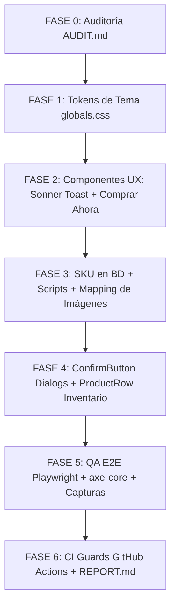

# AUDIT.md — FASE 0: Auditoría Inicial E-Commerce Fix Sprint

> **Squad:** Senior Full-Stack Lead Engineer, UX Director, QA Engineer & DevOps  
> **Fecha de Auditoría:** 20 de Octubre de 2026  
> **Proyecto:** SportX — Tienda Deportiva de Alto Rendimiento  
> **Estado:** FASE 0 COMPLETADA (Código base inspeccionado sin modificaciones)

---

## 1. Verificación y Detección de Stack Tecnológico

| Elemento | Stack Asumido (Master Prompt) | Stack Real Detectado (package.json) | Estrategia de Adaptación |
| :--- | :--- | :--- | :--- |
| **Framework Web** | Next.js 14/15 (App Router) | **React 18.3.1 + Vite 5.4.11 + React Router v6.28.0 (SPA)** | Implementar componentes estándar React 18 compatibles con SSR/SPA, con rutas canónicas en React Router. |
| **Backend / DB** | Prisma o Supabase | **Express 4.21.1 + Drizzle ORM 0.36.4 + PGlite 0.5.10 (PostgreSQL WASM)** | Añadir migración y columna `sku` mediante Drizzle Kit y PGlite en `server/db/schema.ts`. |
| **Estilos** | TailwindCSS + shadcn/ui | **TailwindCSS 3.4.15 + PostCSS + CSS Variables** | Configurar tokens semánticos en `globals.css` / `index.css` y `tailwind.config.js`. Instalar `@radix-ui/react-alert-dialog` para popups accesibles. |
| **Tema (Dark/Light)** | next-themes | **ThemeProvider Context (`src/context/ThemeProvider.tsx`)** | Compatible con clase `.dark` / `.light` en `<html>` sin FOUC. |
| **Imágenes** | next/image | **`ProductImageWrapper` (`` optimizado con lazy/fallback)** | Crear componente unificado `<ProductImage>` con fallback estandarizado por categoría en `/public/placeholder/`. |
| **Estado Global** | Zustand o Context | **React Context (`CartContext`, `AuthContext`, `ThemeProvider`)** | Mantener arquitectura de Contexts sin dependencias externas innecesarias. |
| **Feedback Toasts** | sonner | **Feedback inline y rebote en carrito (Sonner no instalado)** | Instalar `sonner` y agregarlo en la raíz `Layout` de `App.tsx`. |
| **Testing / QA** | Playwright + axe-core | **Sin suite de testing configurada en package.json** | Configurar Playwright y axe-core para pruebas de contraste y flujos críticos. |
| **Control de Versiones**| Git con ramas atómicas | **Repositorio Git no inicializado en la carpeta** | Inicializar `git init`, crear commit baseline y trabajar con ramas `fix/*` y `feat/*`. |

---

## 2. Diagnóstico Detallado de Bugs e Inconsistencias

### 2.1 Bug 1: Light Mode — Contraste Insuficiente (WCAG AA)

* **1.1 Estrellas de Puntaje (Rating):**
  * **Ubicaciones:** [src/pages/ProductDetail.tsx:183-201](file:///c:/Users/franc/OneDrive/Escritorio/sportx/src/pages/ProductDetail.tsx#L183-L201) y [src/components/ProductCard.tsx:51-54](file:///c:/Users/franc/OneDrive/Escritorio/sportx/src/components/ProductCard.tsx#L51-L54).
  * **Problema:** En el detalle de producto, las estrellas se renderizan con `fill-amber-400 text-amber-400` directamente sobre fondo claro sin contenedor que garantice legibilidad. El contraste de `amber-400` sobre blanco es de apenas **1.71:1** (Falla crítica de accesibilidad, mínimo requerido 4.5:1).
  * **Solución requerida:** Envolver el rating en un badge de alto contraste con tokens semánticos `--rating-bg` (`bg-neutral-900`) y `--rating-fg` (`text-white`) tanto en light como en dark mode.

* **1.2 Precio en Página de Detalle:**
  * **Ubicación:** [src/pages/ProductDetail.tsx:204-206](file:///c:/Users/franc/OneDrive/Escritorio/sportx/src/pages/ProductDetail.tsx#L204-L206).
  * **Código actual:**
    ```tsx
    <div className="mt-6 font-mono text-4xl font-black text-accent drop-shadow-[0_0_12px_rgba(204,255,0,0.3)]">
      {money(p.price)}
    </div>
    ```
  * **Problema:** `text-accent` corresponde al color neón `#CCFF00`. En modo claro sobre fondo blanco (`#ffffff`), el ratio de contraste es de **1.16:1**, haciéndolo completamente ilegible.
  * **Solución requerida:** Crear tokens `--price-bg` y `--price-fg`. Envolver el precio en una píldora atlética oscura: `<span className="inline-flex items-center rounded-xl bg-neutral-900 px-4 py-2 text-white font-mono text-3xl font-black">`.

* **1.3 Textos de Estado Verde (Success) en Light Mode:**
  * **Ubicaciones:** [src/components/Footer.tsx:144](file:///c:/Users/franc/OneDrive/Escritorio/sportx/src/components/Footer.tsx#L144), [src/dashboards/shared.tsx:53](file:///c:/Users/franc/OneDrive/Escritorio/sportx/src/dashboards/shared.tsx#L53).
  * **Problema:** Empleo de verdes claros o acentos neón para estados exitosos.
  * **Solución requerida:** Definir la clase de utilidad `@layer components { .text-success-safe { @apply text-emerald-700 dark:text-emerald-300; } }` y `.badge-success { @apply bg-emerald-900 text-emerald-100; }` que superan el ratio 4.5:1.

---

### 2.2 Bug 2: Integridad y Arquitectura de Imágenes por SKU

* **2.1 Ausencia del Atributo SKU en Base de Datos y Tipos:**
  * **Ubicaciones:** [server/db/schema.ts:37-51](file:///c:/Users/franc/OneDrive/Escritorio/sportx/server/db/schema.ts#L37-L51), [src/types.ts:22-37](file:///c:/Users/franc/OneDrive/Escritorio/sportx/src/types.ts#L22-L37).
  * **Problema:** La tabla `products` cuenta con `id`, `name`, `slug`, `brand`, `description`, `price`, `images`, `category`, `sizes`, `stock`, `rating`, `seller_id`, pero **no posee el campo `sku`**.
  * **Impacto:** Imposible vincular archivos de imagen al SKU o validar `filename ↔ SKU` según la Regla Dura.
  * **Solución requerida:**
    1. Modificar esquema Drizzle agregando `sku: text("sku").notNull().unique()`.
    2. Actualizar tipos TypeScript e interfaz de productos.
    3. Generar SKUs estandarizados (`SPX-ZAP-001`, `SPX-ROP-002`, `SPX-PEL-003`, `SPX-ACC-004`) en la semilla.

* **2.2 Falta de Scripts de Auditoría y Validación:**
  * **Problema:** No existen `scripts/audit-product-images.ts` ni `scripts/validate-image-sku.ts`.
  * **Solución requerida:** Crear los scripts con TypeScript (`tsx`) para verificar existencia HTTP/local, consistencia de nombre de archivo y generar `AUDIT_IMAGES.md`.

* **2.3 Fallback de Placeholders por Categoría:**
  * **Problema:** No existen los archivos en `public/placeholder/placeholder-{category}.webp`.
  * **Solución requerida:** Generar los placeholders limpios para `zapatillas`, `ropa`, `pelotas` y `accesorios`.

---

### 2.3 Bug 3: Toast "Agregado" Efímero / Inexistente

* **Ubicaciones:** [src/pages/ProductDetail.tsx:78-83](file:///c:/Users/franc/OneDrive/Escritorio/sportx/src/pages/ProductDetail.tsx#L78-L83) y [src/components/ProductCard.tsx:16-22](file:///c:/Users/franc/OneDrive/Escritorio/sportx/src/components/ProductCard.tsx#L16-L22).
* **Problema:** Al agregar un producto, la interfaz solo muestra un cambio momentáneo en el texto del botón (`doneLabel`) o un rebote en el ícono del carrito. No existe un toast accesible con duración mínima de 3 segundos ni botón directo a la bolsa.
* **Solución requerida:**
  1. Instalar `sonner`.
  2. Montar `<Toaster duration={3500} closeButton position="top-right" richColors />` en el Layout de `App.tsx`.
  3. Disparar `toast.success(`${product.name} agregado a la bolsa`, { action: { label: "Ver bolsa", onClick: () => setOpen(true) } })`.

---

### 2.4 Bug 4: Ausencia del Botón "Comprar Ahora" en Detalle de Producto

* **Ubicación:** [src/pages/ProductDetail.tsx:251-261](file:///c:/Users/franc/OneDrive/Escritorio/sportx/src/pages/ProductDetail.tsx#L251-L261).
* **Código actual:**
  ```tsx
  <ShimmerButton disabled={p.stock === 0} onClick={handleAddToCart} className="w-full !py-4">
    {p.stock === 0 ? "Agotado Temporalmente" : `Agregar al Carrito • ${money(Number(p.price) * quantity)}`}
  </ShimmerButton>
  ```
* **Problema:** Falta el botón prioritario "Comprar ahora" que agregue el producto y redirija instantáneamente al flujo de `/checkout`.
* **Solución requerida:**
  * Estructura responsiva de dos botones (apilados en mobile, horizontales en desktop):
    ```tsx
    <div className="flex flex-col gap-3 sm:flex-row mt-6">
      <button onClick={handleAddToCart} className="btn-ghost flex-1 py-4 text-xs font-bold uppercase tracking-wider">
        Agregar a la Bolsa
      </button>
      <button onClick={handleBuyNow} className="btn-primary flex-1 py-4 text-xs font-black uppercase tracking-wider">
        Comprar Ahora
      </button>
    </div>
    ```

---

### 2.5 Bug 5: Mutaciones Administrativas Sin Confirmación (Popup Guard)

* **Ubicaciones:** [src/dashboards/AdminDashboard.tsx:42-55](file:///c:/Users/franc/OneDrive/Escritorio/sportx/src/dashboards/AdminDashboard.tsx#L42-L55) y [src/dashboards/shared.tsx:83, 348-361](file:///c:/Users/franc/OneDrive/Escritorio/sportx/src/dashboards/shared.tsx).
* **Problemas:**
  1. **Suspender usuario:** Se ejecuta directamente con un clic sin modal de confirmación.
  2. **Cambio de rol:** Se ejecuta inmediatamente al cambiar el `<select>`.
  3. **Ajuste de inventario (stock):** Aplica la mutación sin confirmación previa del delta de unidades.
  4. **Eliminar producto:** Utiliza el diálogo bloqueante nativo `window.confirm()`.
* **Solución requerida:**
  * Crear `src/components/WithConfirm.tsx` / `ConfirmButton` basado en `@radix-ui/react-alert-dialog` con título, descripción, botón de cancelación y botón de confirmación con variantes visuales de peligro/acción.
  * Reemplazar todas las mutaciones por dicho componente.

---

### 2.6 Bug 6: Inventario Global — Falta de Thumbnail a la Izquierda y Desunificación

* **Ubicaciones:** [src/dashboards/shared.tsx:122-137](file:///c:/Users/franc/OneDrive/Escritorio/sportx/src/dashboards/shared.tsx#L122-L137) (Panel Productos) vs [src/dashboards/shared.tsx:373-380](file:///c:/Users/franc/OneDrive/Escritorio/sportx/src/dashboards/shared.tsx#L373-L380) (Panel Inventario).
* **Problema:** En el panel de Inventario, la tabla muestra únicamente el texto del nombre del producto, sin miniatura. Ambas vistas duplican estructura y no comparten un componente común.
* **Solución requerida:**
  * Extraer `<ProductRow>` unificado:
    `[Thumbnail 48×48] [Nombre + SKU] [Categoría] [Stock] [Precio] [Acciones]`
  * Reutilizar `<ProductRow>` tanto en el Catálogo de Productos como en el Control de Stock de Inventario.

---

## 3. Plan de Fases de Ejecución



1. **FASE 1 — Tokens de Tema:**
   * Ramas: `fix/theme-stars`, `fix/price-contrast`, `fix/success-contrast`.
   * Tokens en CSS: `--rating-bg`, `--rating-fg`, `--price-bg`, `--price-fg`, `--success-fg`.
2. **FASE 2 — Componentes UX:**
   * Ramas: `feat/sonner-toast`, `feat/buy-now`.
   * Integración de `sonner` con acción "Ver bolsa" y botón "Comprar ahora" con redirección a `/checkout`.
3. **FASE 3 — Integridad de Datos y Media:**
   * Ramas: `feat/sku-architecture`, `fix/product-images`.
   * Migración de esquema Drizzle para columna `sku`, script `audit-product-images.ts`, `validate-image-sku.ts`, y placeholders por categoría.
4. **FASE 4 — Seguridad Administrativa & Layout:**
   * Ramas: `feat/confirm-dialogs`, `refactor/inventory-layout`.
   * `ConfirmButton` (Radix AlertDialog) en todas las acciones admin. Extracción y uso de `<ProductRow>` con thumbnail 48×48.
5. **FASE 5 — QA & Testing:**
   * Pruebas de contraste automatizadas con `axe-core`, tests Playwright para light y dark mode.
6. **FASE 6 — CI Guards & Documentación:**
   * Configuración de GitHub Actions `.github/workflows/qa.yml`, generación de `REPORT.md` final y changelog.

---

## 4. Estado de Verificación Inicial (Baseline)

* [x] `tsc --noEmit`: **0 errores** (TypeScript Strict mode pasando exitosamente).
* [x] Servidor Backend (API Express + PGlite): **Activo en http://localhost:3001**
* [x] Servidor Frontend (Vite + React): **Activo en http://localhost:5173**
* [x] Detección de incompatibilidades: **Identificadas y mapeadas a la arquitectura React/Vite/Drizzle**.

> **Siguiente Paso:** Confirmar diagnóstico y autorizar el inicio de **FASE 1 (Tokens de Tema)** con la rama `fix/theme-stars`.
